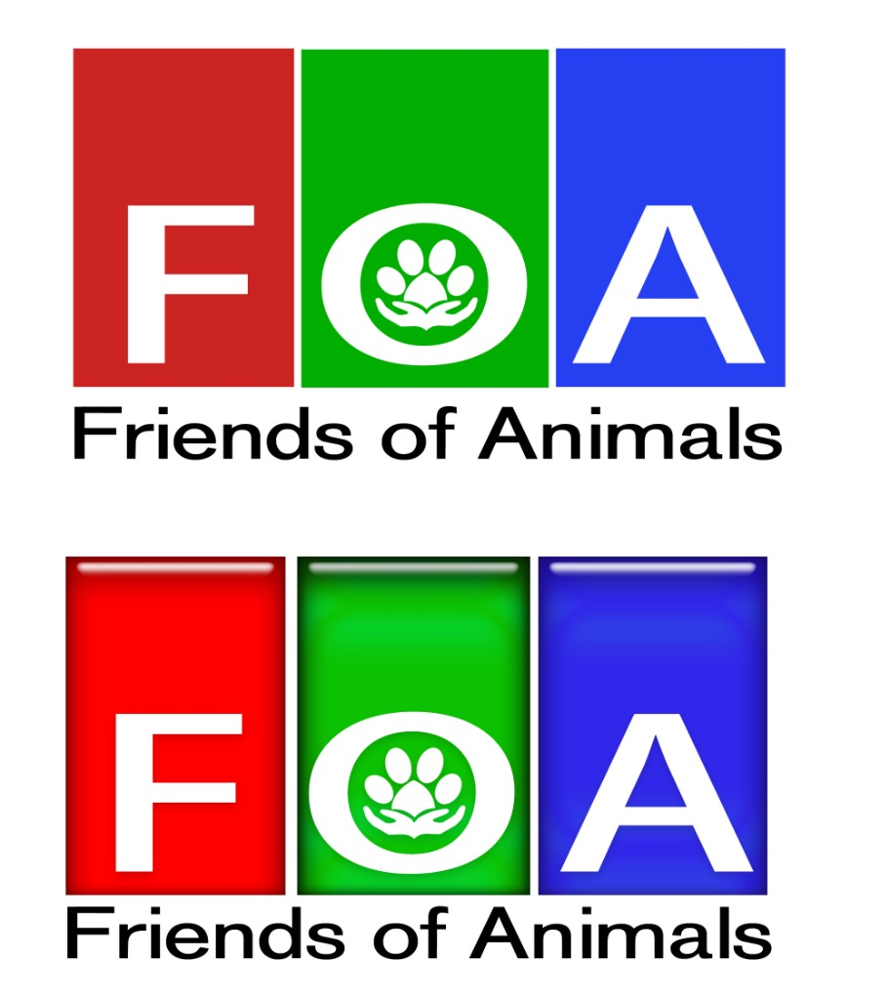

# Friends of Animals (FOA) — Full-Stack Platform

<div align="center">
  
  <p><strong>Nurturing Compassion for Animals Through Creative Expression</strong></p>
  <p>
    <a href="https://web-ten-delta-88.vercel.app"><strong>View Live Production Site »</strong></a>
  </p>
</div>

---

## 🐾 Overview

**Friends of Animals (FOA)** (`foaglobal.org`) is a nationwide and global social-impact platform designed to promote empathy and compassion for animals through student competitions, art showcases, awareness campaigns, community participation, and fundraising.

This platform bridges young student creators, educational institutions, animal rescue organizations, and donors to turn children's artistic creativity into tangible aid for injured, abandoned, and working animals.

---

## 🚀 Live Demo & Testing

- **Live URL**: [https://web-ten-delta-88.vercel.app](https://web-ten-delta-88.vercel.app)
- **Status**: Running 24x7 on Vercel Edge Network

### Demo Login Accounts:
| Role | Email | Password | Access Portal |
| :--- | :--- | :--- | :--- |
| **FOA Super Admin** | `admin@foaglobal.org` | `Admin@12345` | `/admin` (Overview, Competitions, School verification, Submissions review, Physical tracking) |
| **School Coordinator** | `coordinator@delhipublic.edu` | `School@12345` | `/school-dashboard` (School profile & shortlisted student uploads) |
| **Student / Participant** | `aarav.sharma@example.com` | `Student@12345` | `/participant-dashboard` (Artwork entries & verifiable certificates) |

---

## ✨ Key Features

### 1. Public Web Portal (21 Routes)
- **Home (`/`)**: Hero mission, competition discovery, artwork showcase, and transparency metrics.
- **Competitions (`/competitions`, `/competitions/:slug`)**: Competition rules, eligibility criteria, date schedules, and submission forms.
- **Artwork Gallery (`/gallery`, `/gallery/:id`)**: High-res student gallery with minor-privacy safeguards and artist empathy statements.
- **Charity Auctions (`/auctions`, `/auctions/:id`)**: Online fundraising auctions for verified physical artworks with real-time bidding.
- **Donation Flow (`/donate`)**: Impact-allocated donation system supporting animal medical kits and food drives.
- **Awareness & Community (`/animal-welfare`, `/community`, `/volunteer`, `/organizations`)**: Educational animal-care guides and NGO directories.
- **QR Certificate Verification (`/verify/:certificateNumber`)**: Public tamper-proof certificate authenticity checking.

### 2. Multi-Role Dashboards
- **Admin Operations Suite (`/admin`)**:
  - Live aggregated KPIs (Total competitions, submissions, schools, donations).
  - Full competition lifecycle: Draft, date validation, and instant live publication.
  - Institutional verification: Review, approve, or reject school applications.
  - Review & Gallery Curation: Approve entries for public display after guardian consent verification.
  - Physical Artwork Tracking: Monitor courier dispatches, transit, and condition notes.
  - Audit logging of all administrative actions.
- **School Coordinator Portal (`/school-dashboard`)**:
  - School campus dashboard, student entry tracking, and school-level shortlisting (Top 5 / Top 10 entries).
- **Participant Dashboard (`/participant-dashboard`)**:
  - Student entry management, consent records, submission statuses, and official certificate downloads.

### 3. Minor Safeguarding & Privacy by Design
- Minors' personal phone numbers, residential addresses, and exact dates of birth are strictly private and never exposed on public pages or APIs.
- Separate consent requirements for participation, public gallery showcases, and fundraising auctions.

---

## 🛠️ Technology Stack

- **Frontend**: React 18, TypeScript, Vite, Tailwind CSS, Lucide Icons, TanStack Query.
- **Backend API**: Node.js, Express.js, TypeScript, Zod input validation, JWT HttpOnly sessions.
- **Database**: PostgreSQL (Production) / SQLite (Local zero-config dev) managed with Prisma ORM.
- **Hosting & Infrastructure**: Vercel (Frontend & Serverless API functions), Docker Compose for local PostgreSQL.

---

## 📁 Monorepo Structure

```text
foa-platform/
├── apps/
│   ├── web/                    # React 18 + Vite Frontend & Vercel Serverless API
│   │   ├── api/                # Vercel Serverless Function (/api/v1/*)
│   │   ├── public/             # Static brand assets (foa-logo.jpg)
│   │   ├── src/                # Pages, Components, Context, and API client
│   │   └── vercel.json         # SPA fallback & API route rewrites
│   │
│   └── api/                    # Standalone Node.js + Express REST API
│       ├── prisma/             # Prisma schema, migrations & seed script
│       ├── src/
│       │   ├── middleware/     # Auth, RBAC, and Zod validation middleware
│       │   ├── routes/         # Modular REST endpoints
│       │   └── services/       # Storage & notification adapters
│       └── tests/              # Vitest + Supertest API integration tests
│
├── packages/
│   └── shared/                 # Shared TypeScript models and Zod schemas
│
├── docs/                       # Project documentation
│   ├── PROJECT_PLAN.md         # Multi-tier stakeholder framework
│   ├── ARCHITECTURE.md         # Mermaid system architecture & workflow diagrams
│   ├── DATABASE_SCHEMA.md      # Relational entity models and dictionary
│   ├── API_REFERENCE.md        # REST API endpoint reference
│   └── SETUP.md                # Local setup guide
│
├── docker-compose.yml          # Optional local PostgreSQL container
└── package.json                # Monorepo workspaces configuration
```

---

## 💻 Local Development Setup

### Prerequisites
- Node.js 18+ (tested on Node v20 / v22 / v24)
- npm v9+

### 1. Clone the repository
```bash
git clone https://github.com/dhrunilshah/foa-platform.git
cd foa-platform
```

### 2. Install dependencies
```bash
npm install
```

### 3. Run Backend API
```bash
cd apps/api
npm run prisma:push
npm run prisma:seed
npm run dev
```
*API runs at `http://localhost:4000/api/v1`*

### 4. Run Frontend
In a new terminal:
```bash
cd apps/web
npm run dev
```
*Frontend runs at `http://localhost:5173`*

---

## 🧪 Running Automated Tests

Run backend API integration tests with Vitest:
```bash
cd apps/api
npm run test
```

---

## 📄 License & Ownership

Friends of Animals (FOA) Platform. All rights reserved. Built for animal welfare, education, and community engagement.
