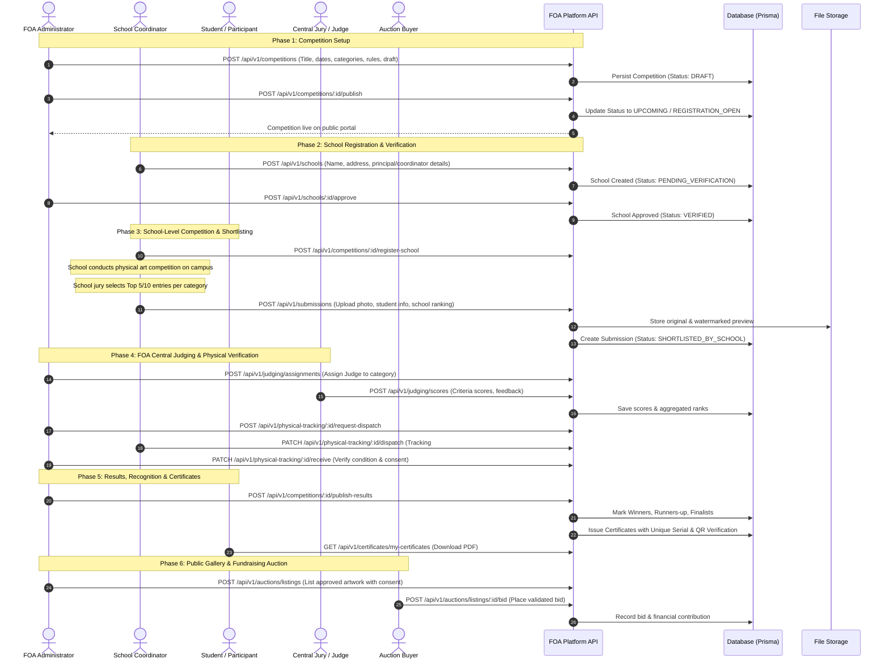

# Friends of Animals (FOA) — System Architecture

## 1. System Overview
The Friends of Animals (FOA) platform is architected as a clean, modular full-stack application following domain-driven design principles. The platform is designed to run efficiently in development with zero external vendor dependencies, while being fully ready for enterprise-grade deployment on Amazon Web Services (AWS) using modular adapters.

## 2. High-Level System Architecture Diagram (Mermaid)

```mermaid
graph TD
    subgraph Client Layer
        Web["Web Frontend (React 18 + Vite + Tailwind CSS)"]
        AdminUI["Admin Dashboard (/admin)"]
        SchoolUI["School Dashboard (/school-dashboard)"]
        ParticipantUI["Participant Dashboard (/participant-dashboard)"]
        PublicUI["Public Portal (Competitions, Gallery, Auctions, Donate)"]
        Web --> AdminUI
        Web --> SchoolUI
        Web --> ParticipantUI
        Web --> PublicUI
    end

    subgraph API Gateway & Security Layer
        ExpressAPI["Express REST API (/api/v1)"]
        RateLimiter["Rate Limiting & Helmet"]
        AuthMiddleware["JWT & HttpOnly Session Middleware"]
        RBAC["Role-Based Access Control (RBAC)"]
        ExpressAPI --> RateLimiter
        RateLimiter --> AuthMiddleware
        AuthMiddleware --> RBAC
    end

    subgraph Service & Domain Logic
        CompService["Competition Management Service"]
        SchoolService["School & Verification Service"]
        SubService["Submission & Artwork Service"]
        JudgingService["Judging & Evaluation Service"]
        CertService["Certificate & QR Verification Service"]
        AuctionService["Auction & Bidding Service"]
        DonationService["Donation & Transparency Service"]
        AuditService["Audit Logging Service"]
    end

    subgraph Replaceable Adapters
        StorageAdapter["Storage Adapter (Local Dev File System / AWS S3)"]
        NotificationAdapter["Notification Adapter (Console / SMTP / AWS SES)"]
        PaymentAdapter["Payment Adapter (Mock / Razorpay)"]
    end

    subgraph Data & Persistence Layer
        PrismaORM["Prisma ORM (Schema & Migrations)"]
        DB[(PostgreSQL / SQLite Database)]
        PrismaORM --> DB
    end

    Client Layer -->|HTTP / REST JSON| ExpressAPI
    RBAC --> CompService
    RBAC --> SchoolService
    RBAC --> SubService
    RBAC --> JudgingService
    RBAC --> CertService
    RBAC --> AuctionService
    RBAC --> DonationService
    RBAC --> AuditService

    CompService --> PrismaORM
    SchoolService --> PrismaORM
    SubService --> PrismaORM
    SubService --> StorageAdapter
    JudgingService --> PrismaORM
    CertService --> PrismaORM
    AuctionService --> PrismaORM
    DonationService --> PaymentAdapter
    AuditService --> PrismaORM
    ExpressAPI --> NotificationAdapter
```

---

## 3. End-to-End Competition Workflow Diagram (Mermaid)



---

## 4. Key Architectural Guarantees
1. **Decoupled Infrastructure**: No hard vendor lock-in. Any storage, notification, or payment gateway can be swapped with zero changes to core domain logic.
2. **Student & Minor Privacy By Design**: Minors' dates of birth, phone numbers, and guardian contacts are strictly confidential and never rendered on public views.
3. **Double Review Gate for Artworks**: Artwork cannot be displayed in the public gallery or listed for auction without:
   - Approved submission review status
   - Explicit guardian consent on file
   - Admin authorization check
4. **Resilient Offline / Local First Development**: Fully runs with zero cloud expenses, with straightforward promotion to AWS S3, Amazon RDS PostgreSQL, and AWS ECS in production.
